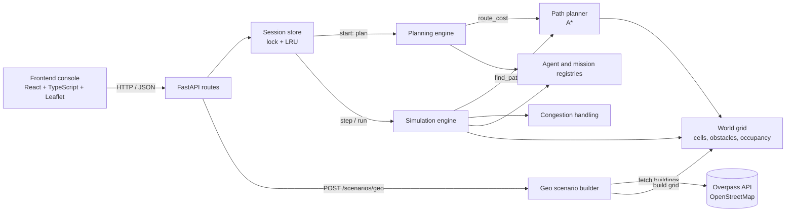
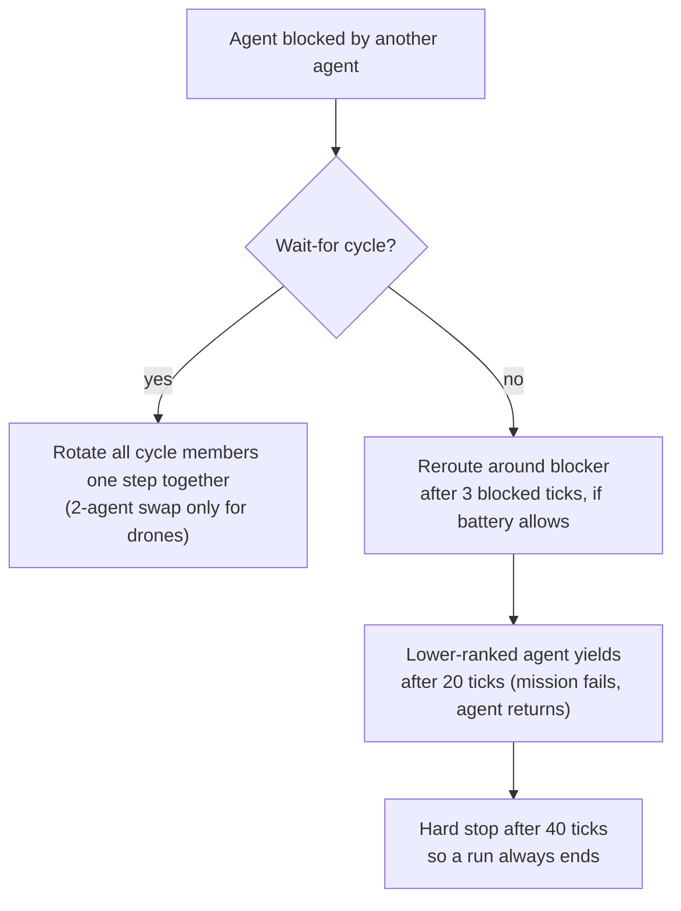

# ARGUS: Multi-Agent Fleet Simulator


**ARGUS simulates a fleet of drones and ground robots that receive missions, plan routes, share a crowded map, avoid deadlocks, and manage battery, on a grid that can be built from real OpenStreetMap buildings.**

A backend of layered engines (planning, A* routing, tick-based simulation) behind a thread-safe FastAPI service, with a React + Leaflet operations console. Built solo, with design docs, 529 tests, CI and benchmarks.

<!-- Add a screenshot or GIF after you capture it, then uncomment:

-->

> **Status:** runs locally or in Docker. Not deployed to a public URL yet.

---

## Why this project

Coordinating many autonomous machines is hard. Someone must decide who does which job, which path to take, what happens when two machines want the same corridor, and what happens when battery runs low. Testing those decisions on real hardware is slow and risky, so ARGUS lets you try them safely in software.

It is also a study in backend engineering: layered design, graph algorithms, concurrency, retries, caching, testing and measurable results.

## Highlights

- **A\* routing** on an 8-direction grid with an octile heuristic, corner-cutting prevention and deterministic tie-breaking.
- **Mission planning** by priority and capability. Agents are chosen by **real route distance** and a **round-trip battery check**.
- **Deadlock detection and recovery** using a wait-for graph (details below). Runs that finish rose from 21.5% to 100% in seeded stress tests.
- **Tick-based simulation engine** with battery accounting, safety checks, multi-waypoint area coverage and return-to-launch.
- **Real map scenarios**: building footprints from the OpenStreetMap Overpass API are rasterized into obstacle grids using hand-written geometry (point-in-polygon and segment intersection).
- **Reliable external calls**: retries with exponential backoff, mirror fallback and a bounded TTL cache for Overpass.
- **Thread-safe API**: per-session locks, bounded LRU session store, `/health`, configurable CORS.
- **Engineering habits**: 15 design documents, 529 tests, GitHub Actions CI, Dockerfile, reproducible benchmarks.

## Architecture



Each layer has one job and depends only on layers below it, so every piece can be tested alone.

| Layer | Responsibility |
|---|---|
| `world` | Grid, obstacles, which cells are occupied |
| `agent`, `mission` | Immutable data objects and validating registries |
| `path_planner` | A* routing and route cost estimates |
| `planning` | Decides which agent takes which mission |
| `simulation` | Advances time one tick at a time, handles conflicts |
| `geo` | Turns real map data into a World |
| `scenario` | Helper that plans and runs a scenario to completion |
| `api` | HTTP layer, sessions, locking. No business logic |

## How it works

**1. Planning.** Missions are sorted CRITICAL to LOW. An agent is eligible if it is online, idle and has the required capabilities. Among eligible agents, ARGUS picks the nearest one whose battery covers a round trip (`battery >= 2 x route cost`), falling back to highest battery if nobody qualifies.

**2. One simulation tick.** The engine starts newly assigned missions (failing any that cannot be completed on the battery), resolves blocked agents, moves every active agent one cell if the next cell is free, spends battery, completes missions, and sends agents back to their launch point.

**3. Deadlock handling.** If agents block each other, simply waiting can last forever (for example, two robots meeting head-on in a one-cell corridor). ARGUS recovers in layers:



Rank is mission priority first, then agent id as a deterministic tie-break.

## Results

All benchmarks use seeded random scenarios, so they are reproducible (`backend/benchmarks/`). They are synthetic and show relative effect, not real-world performance.

| Experiment | Before | After |
|---|---|---|
| Runs that finish (200 stress scenarios: walled map, narrow doors, 8 agents, 8 missions) | 21.5% | 100% |
| Missions completed per run (drones) | 4.04 | 7.04 |
| Mean mission completion, distance-aware vs battery-only assignment (200 seeded runs) | 14.5 ticks | 6.9 ticks |
| Concurrent `/step` requests that failed (40 parallel calls, 15 trials) | 13 of 600 returned HTTP 500 | 0 of 600 |

Notes: the battery-only baseline ignores distance, so it is a simple baseline. Ground robots cannot swap cells, so a head-on corridor encounter costs them one mission (they fail 2.29 missions per run versus 0.96 for drones).

## Getting started

**Requirements:** Python 3.12+, Node 20+ (for the frontend), Docker (optional).

```bash
# Backend
cd backend
pip install -r requirements-dev.txt
python -m pytest -q                      # run the test suite
uvicorn app.api.main:app --reload        # API at http://localhost:8000  (docs at /docs)

# Frontend (new terminal)
cd frontend
npm install
npm run dev                              # http://localhost:5173

# Or run the backend in Docker
docker build -t argus-api backend
docker run -p 8000:8000 argus-api
```

**Configuration**

| Variable | Where | Purpose |
|---|---|---|
| `ARGUS_CORS_ORIGINS` | backend | Comma-separated origins allowed to call the API (default `http://localhost:5173`) |
| `VITE_API_BASE_URL` | frontend | API address when the frontend is hosted separately |
| `PORT` | backend | Port for the server inside Docker (default 8000) |

## API quick start

| Method | Endpoint | Purpose |
|---|---|---|
| POST | `/scenarios` | Create a scenario, returns `session_id` |
| POST | `/scenarios/geo` | Create a scenario from real OpenStreetMap buildings |
| GET | `/scenarios/{id}` | Full state: world, agents, missions, summary |
| POST | `/scenarios/{id}/start` | Run the planner |
| POST | `/scenarios/{id}/step` | Advance one tick |
| POST | `/scenarios/{id}/run` | Advance up to `max_ticks` or until settled |
| GET | `/scenarios/{id}/metrics` | Agent, mission and simulation summaries |
| GET | `/scenarios/{id}/agents/{agent_id}/route` | An agent's active route |
| GET | `/health` | Liveness check |

```bash
# create a scenario
curl -X POST localhost:8000/scenarios -H 'content-type: application/json' -d '{
  "world": {"width": 20, "height": 20},
  "obstacles": [],
  "agents": [{"id": "d1", "platform_type": "DRONE", "x": 0, "y": 0, "battery_level": 100, "capabilities": []}],
  "missions": [{"id": "m1", "name": "Inspect", "description": "Visit target", "priority": "HIGH",
                "target_cells": [[10, 10]], "required_capabilities": []}]
}'
# then: POST /scenarios/{session_id}/start  and  POST /scenarios/{session_id}/run
```

Interactive docs are available at `/docs` while the server runs.

## Testing

```bash
cd backend
python -m pytest -q                                          # 529 tests
python benchmarks/congestion_benchmark.py --runs 200 --platform DRONE
python benchmarks/assignment_benchmark.py --runs 200
```

The suite covers unit tests per layer, API tests, determinism tests, regression tests (including a multi-threaded test that fails on the old code), and mocked-network tests for retry and cache behavior. CI runs the backend tests, a small benchmark sample and the frontend build on every push.

## Project structure

```
backend/
  app/
    world/  agent/  mission/      domain model and validating registries
    path_planner/                 A* and route cost
    planning/                     mission assignment
    simulation/                   tick engine and congestion handling
    geo/                          OpenStreetMap to grid
    scenario/                     scenario runner
    api/                          FastAPI routes, schemas, sessions
  tests/                          529 tests
  benchmarks/                     seeded, reproducible experiments
frontend/                         React + TypeScript + Leaflet console
docs/                             15 design documents (model + API per layer)
```

Design decisions for every layer are written up in [`docs/`](docs/).

## Limitations and roadmap

**Known limitations**
- Sessions are in memory and single-process, so there is no persistence and the server runs one worker.
- Deadlock handling is reactive, not optimal; ground robots in a corridor with no passing room still lose a mission.
- Drones may swap cells head-on (assumption: they fly at different altitudes).
- Assignment is greedy per mission rather than globally optimal.
- Charging stations exist in the world model, but agents do not recharge yet.

**Roadmap**
- [ ] Cooperative A* with a space-time reservation table to avoid conflicts up front
- [ ] Optimal assignment (Hungarian algorithm)
- [ ] Battery-aware charging behavior
- [ ] WebSocket streaming of ticks to the console
- [ ] Redis or Postgres sessions for multi-worker deployment
- [ ] Frontend tests; public deployment

## Research paper

<!-- Fill in once, then delete this comment. -->
This work is described in: **[PAPER TITLE]**, *[Authors]*, [Venue / Journal, Year]. **[Read the paper](PASTE_LINK_HERE)**

